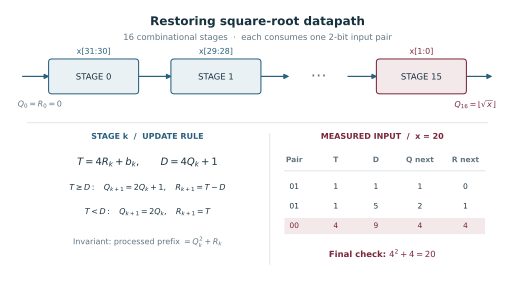
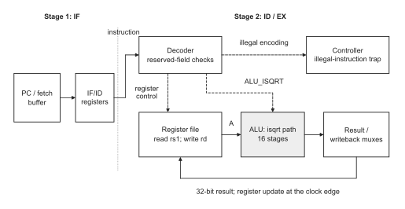
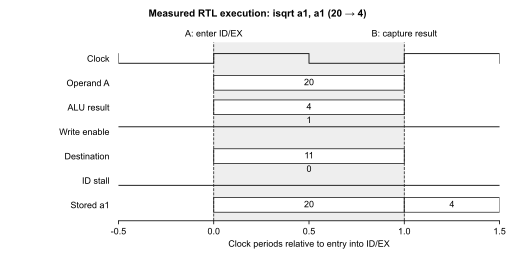
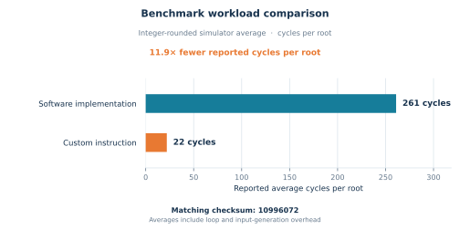
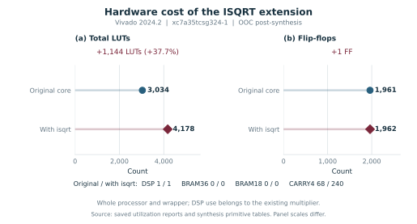
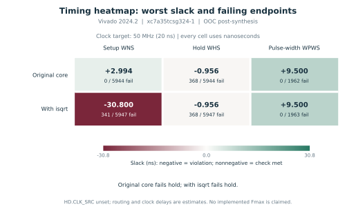
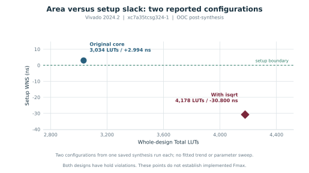
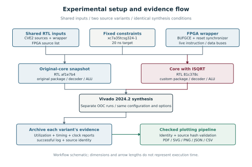
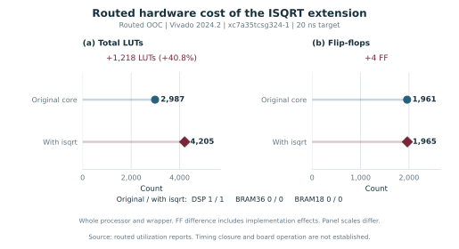
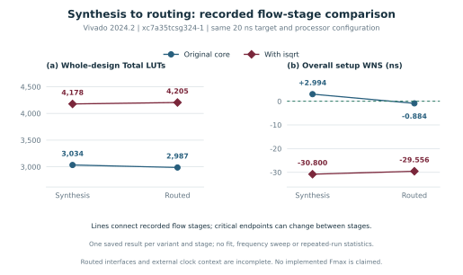

# Integer square root for CVE2

This project adds an unsigned integer square-root instruction to CVE2, a compact
32-bit RISC-V processor. The goal is to calculate a result in hardware, verify
the instruction in simulation, and measure its implementation cost on an FPGA.

The [FPGA build guide](fpga/README.md) describes synthesis and placement/routing.
The [routed OOC comparison](output/fpga/implementation/comparison.md) reports
2,987 LUTs for the original core and 4,205 with isqrt (+40.8%). The worst
reported register setup slack changes from +0.058 ns to -29.556 ns at a
50 MHz target. Both complete design reports fail timing, with incomplete
external clock and interface context. The verified vectorless power run
estimates 86 mW for the original core and 101 mW with isqrt at the assumed
50 MHz clock. The comparison, integration results and reproduction commands
are in the [technical handoff](output/fpga/verified_results.md).

The [project documentation](docs/index.md) brings the design, waveform and
FPGA results together. To preview the site locally with Python 3.11 or newer:

```sh
python3 -m venv tmp/docs-venv
source tmp/docs-venv/bin/activate
python -m pip install -r requirements-docs.txt
zensical serve
```

## 1. Mathematical definition

For an unsigned input (x), the integer square root (r) is

$$
r = \left\lfloor \sqrt{x} \right\rfloor,
\qquad
r^2 \leq x < (r+1)^2.
$$

The inequalities are also a useful correctness check: (r) fits below (x),
but the next integer does not.

For example, when (x=20):

$$
4^2 = 16 \leq 20 < 25 = 5^2,
\qquad
\therefore \left\lfloor \sqrt{20} \right\rfloor = 4.
$$

For a 32-bit unsigned input,

$$
0 \leq x \leq 2^{32}-1 = 4{,}294{,}967{,}295.
$$

The maximum result is 65,535, since

$$
65{,}535^2 = 4{,}294{,}836{,}225 \leq 2^{32}-1
< 65{,}536^2 = 4{,}294{,}967{,}296.
$$

The result therefore needs 16 significant bits and is zero-extended into the
32-bit destination register.

| Input | Result | Check |
|---:|---:|---|
| 0 | 0 | 0 squared is 0; 1 squared is greater than 0. |
| 15 | 3 | 3 squared is 9; 4 squared is greater than 15. |
| 16 | 4 | 4 squared is 16; 5 squared is greater than 16. |
| 20 | 4 | 4 squared is 16; 5 squared is greater than 20. |
| 25 | 5 | 5 squared is 25; 6 squared is greater than 25. |

## 2. Instruction format and rules

The instruction is written as:

```text
isqrt rd, rs1
```

Its 32-bit encoding is:

```text
 bits 31:25  24:20  19:15  14:12  11:7   6:0
 ┌─────────┬───────┬──────┬───────┬──────┬─────────┐
 │ 0000000 │ 00000 │ rs1  │  000  │  rd  │ 0001011 │
 └─────────┴───────┴──────┴───────┴──────┴─────────┘
   funct7     rs2             funct3          opcode
```

- The opcode `0001011` (hex `0x0b`) selects RISC-V custom-0.
- `rs1` names the register containing the unsigned input.
- `rd` names the destination register.
- `funct7`, `rs2`, and `funct3` are reserved for this instruction and must be zero.
- Any other custom-0 encoding must raise an illegal-instruction exception.

For `isqrt x5, x6`, the register fields are `rs1=00110` and `rd=00101`.
The instruction word is `0x0003028b`. If x6 contains 20, execution writes
4 into x5 and leaves x6 unchanged.

The register corner cases follow normal RISC-V behavior:

- `rd = rs1`: read the old value, then replace it with its square root.
- `rd = x0`: discard the result; x0 remains zero.
- `rs1 = x0`: read zero, so the result is zero.
- An invalid encoding traps even if its destination is x0.

## 3. Square-root algorithm

The implementation uses the binary digit-by-digit, or restoring,
algorithm. It reads two input bits at a time because each root bit corresponds
to one pair of input bits. Thus a 32-bit input needs 16 iterations.

Let (Q) be the partial root, (R) the partial remainder, and (b\in\{0,1,2,3\})
the next two-bit input pair. Form the candidate remainder (T) and trial value
(D):

$$
\begin{aligned}
T &= 4R+b,\\
D &= 4Q+1.
\end{aligned}
$$

If the trial value fits, subtract it and set the new root bit to one. Otherwise,
keep the candidate remainder and set the new root bit to zero:

If the trial value fits, use:

$$
Q' = 2Q+1,
\qquad
R' = T-D
\quad\text{when } T\geq D.
$$

Otherwise, use:

$$
Q' = 2Q,
\qquad
R' = T
\quad\text{when } T<D.
$$

For input 15, the final three pairs are `00, 11, 11` (earlier pairs are zero).
Starting from (Q=0,R=0), those pairs produce:

| Pair | Candidate (T=4R+b) | Decision | New (Q) | New (R) |
|---:|---:|---|---:|---:|
| 00 | 0 | (D=1) does not fit | 0 | 0 |
| 11 | 3 | (D=1) fits; (3-1=2) | 1 | 2 |
| 11 | 11 | (D=5) fits; (11-5=6) | 3 | 6 |

The result is 3; indeed (3^2+6=15). For input 16, the final pairs are
`01, 00, 00`. They produce roots 1, 2, then 4, with remainder zero.

The recurrence maintains the invariant

$$
P=Q^2+R,
\qquad
0\leq R < 2Q+1,
$$

where (P) is the input prefix processed so far. The next prefix is (4P+b).
Testing (D=4Q+1) is exactly the test for whether the next root bit can be one.

In a sequential circuit, one iteration per clock would take 16 clocks. The
current CVE2 ALU implementation expands all 16 iterations into combinational
logic to aim for one-cycle execution. This may create a long critical path;
actual FPGA timing must be measured before making a frequency claim.

<p align="center">
  
</p>
<p align="center">
  <em>Square-root datapath and worked example.</em><br>
  <a href="output/pdf/fig02_recurrence.pdf">Download vector PDF</a>
</p>

Each stage consumes two input bits and adds one root bit. The example shows
the final three stages for input 20, returning 4. There are no registers
between stages.

## 4. How the instruction fits the processor

CVE2 uses a two-stage pipeline: instruction fetch (IF), followed by combined
decode and execute (ID/EX).

<p align="center">
  
</p>
<p align="center">
  <em>Integration into the CVE2 pipeline.</em><br>
  <a href="output/pdf/fig01_pipeline.pdf">Download vector PDF</a>
</p>

The shaded block shows the square-root path inside the existing ALU. Solid
arrows carry data; dashed arrows carry control signals. Only the relevant
paths are shown.

The signal path is:

1. The IF stage fetches the instruction and places it in the IF/ID registers.
2. The decoder checks the opcode and reserved fields, then selects register `rs1`
   and the `ALU_ISQRT` operation.
3. The register file presents the source value to the ALU.
4. The ALU computes the root and the normal result path carries it to the
   register file write port.
5. If the instruction is legal and executing, the destination register updates
   on the rising clock edge.

The register file reads combinationally and writes on a clock edge. For
`rd=rs1`, the old register value feeds the calculation before the edge; the
new value is written at the edge. This relies on normal setup and hold timing.
The writeback module in this CVE2 version is a passthrough, not an extra pipeline
stage. The instruction should not need a new stall or coprocessor interface.

## 5. Current implementation status

The custom opcode and ALU operation are defined in the package. The decoder
checks all reserved fields, and the ALU now computes the root with 16 unrolled
restoring steps. It returns the result through the existing writeback path.

The supplied tests pass after integration: 5 software checks and 2,007 hardware
checks. These cover known inputs, 2,000 random reference comparisons, an in-place
destination, and a dependent root chain. Standalone ALU lint also passes.
The benchmark prints 247 software cycles and 23 hardware cycles per root, with
the same checksum of 10,996,072. These are integer-rounded averages that include
loop and random-number-generation overhead, not individual instruction latency.

A separate corner-case test passes 43 checks for boundaries, x0 behavior,
four invalid encodings, selected register preservation and recovery after traps.
These results do not establish full ISA regression coverage or FPGA timing.

<p align="center">
  
</p>
<p align="center">
  <em>Verified writeback: input 20 becomes 4 at the next rising edge.</em><br>
  <a href="output/pdf/fig03_writeback.pdf">Download vector PDF</a>
</p>

This plot comes from the captured RTL waveform. The selected instruction reads
20 from `a1` and writes 4 at the next rising edge, with no execution stall.
The horizontal axis counts clock periods, not physical propagation delay.

<p align="center">
  
</p>
<p align="center">
  <em>Measured workload averages, including loop and input-generation overhead.</em><br>
  <a href="output/pdf/fig04_benchmark.pdf">Download vector PDF</a>
</p>

The plotted values and checksum are read from the simulator logs. These averages
compare the complete benchmark workloads; they do not measure the latency of
one square-root instruction. The current figure uses the refreshed macOS run
with GCC 16.2.0: 247 software cycles and 23 hardware cycles per root. The earlier
Ubuntu toolchain run reported 261 and 22; each manifest retains its own tool
and source identity.

### FPGA synthesis comparison

The following figures read the saved Vivado reports for the original and
extended cores. Both use the same Artix-7 part, processor configuration and
20 ns clock target. These are out-of-context post-synthesis estimates.

<p align="center">
  
</p>
<p align="center">
  <em>Paired point plots: 1,144 additional LUTs (+37.7%), one additional FF, and no additional DSP or BRAM.</em><br>
  <a href="output/pdf/fig05_fpga_resources.pdf">Download vector PDF</a>
</p>

<p align="center">
  
</p>
<p align="center">
  <em>Timing heatmap: one signed nanosecond scale, with failing endpoints in each cell. Both designs have hold violations.</em><br>
  <a href="output/pdf/fig06_fpga_timing.pdf">Download vector PDF</a>
</p>

<p align="center">
  
</p>
<p align="center">
  <em>Area versus setup slack: two reported configurations, with no fitted trend or parameter sweep.</em><br>
  <a href="output/pdf/fig07_fpga_tradeoff.pdf">Download vector PDF</a>
</p>

<p align="center">
  
</p>
<p align="center">
  <em>Experimental setup: matching conditions, separate synthesis runs and traceable report outputs.</em><br>
  <a href="output/pdf/fig08_experimental_setup.pdf">Download vector PDF</a>
</p>

The [comparison review](output/fpga/comparison.md) explains the timing limits.
The [parsed JSON](output/pdf/fpga_results.json), [CSV](output/pdf/fpga_metrics.csv)
and [figure manifest](output/pdf/fpga_figure_manifest.json) retain the values,
source hashes and figure captions. These figures describe synthesis.
The later [routed comparison](output/fpga/implementation/comparison.md) reviews
the archived placement/routing results and distinguishes internal setup failure
from incomplete interface timing. The routed data report worst slack.
The [implementation script](fpga/implement.tcl) and [FPGA guide](fpga/README.md#place-and-route-the-saved-synthesis-checkpoints)
provide the run and review commands.

### Routed OOC results

The updated figures use the reviewed routed reports. Their resource counts
and timing values are distinct from the synthesis figures above.

<p align="center">
  
</p>
<p align="center">
  <em>After routing: +1,218 LUTs (+40.8%), with no extra DSP or BRAM.</em><br>
  <a href="output/pdf/fig09_routed_resources.pdf">Download vector PDF</a>
</p>

<p align="center">
  
</p>
<p align="center">
  <em>The extended internal path crosses isqrt_comb and misses the reported 20 ns setup target.</em><br>
  <a href="output/pdf/fig11_routed_path_delay.pdf">Download vector PDF</a>
</p>

<p align="center">
  
</p>
<p align="center">
  <em>Recorded synthesis and routed results. Lines indicate flow order; negative setup slack means the reported check fails.</em><br>
  <a href="output/pdf/fig12_fpga_stage_comparison.pdf">Download vector PDF</a>
</p>

The [four-figure gallery](output/pdf/routed_figures.md) includes all routed
figures and the [timing heatmap](output/pdf/fig10_routed_timing.pdf).
External clock and interface routing limitations remain; these plots do not
establish implemented Fmax or physical timing closure.

## 6. Repository map

- [Package: opcode and ALU operation types](cve2/rtl/cve2_pkg.sv)
- [Decoder: legality and control signals](cve2/rtl/cve2_decoder.sv)
- [ALU: arithmetic and result selection](cve2/rtl/cve2_alu.sv)
- [Software baseline test](sw/sw_isqrt.c)
- [Hardware instruction test](sw/hw_isqrt.c)
- [Boundary, zero-register and illegal-encoding tests](sw/isqrt_corners.c)
- [Square transitions and instruction integration test](sw/isqrt_integration.c)
- [Instruction encoding and C reference](sw/lib/isqrt.h)
- [Processor fetch stage](cve2/rtl/cve2_if_stage.sv)
- [Processor ID/EX stage](cve2/rtl/cve2_id_stage.sv)
- [Execution block](cve2/rtl/cve2_ex_block.sv)
- [Flip-flop register file](cve2/rtl/cve2_register_file_ff.sv)
- [Simulation testbench](tb/tb_top.sv)
- [Paper figure generator and instructions](scripts/README-figures.md)
- [Simulation result collector](scripts/collect_simulation_results.py)
- [Routed FPGA evidence parser](scripts/summarize_fpga_implementation.py)
- [Timing-context and checkpoint audit](scripts/audit_fpga_context.py)

The provided testbench and core configuration are part of the assignment.
The FPGA wrapper, constraints and original/extended synthesis and routed
comparisons are available with the checked vectorless power estimates.
The [timing-context decision](output/fpga/implementation/timing_context.md)
defines the current OOC claims, with [audit commands](fpga/README.md#audit-timing-context-checkpoints-and-missing-logs)
for the checkpoints and missing launch log on the Ubuntu host.

## 7. Set up on an Apple Silicon Mac

You need Apple's C/C++ command-line tools, Verilator, Make, and a RISC-V
cross-compiler. Homebrew provides Apple Silicon packages for Verilator and
RISC-V ELF GCC [1–3].

If the Apple command-line tools are not installed, install them with:

```sh
xcode-select --install
```

If Homebrew is not installed, follow its official [installation guide](https://docs.brew.sh/Installation.html).
Its default prefix on Apple Silicon is `/opt/homebrew`; follow the shell setup
instructions printed by the installer [1]. Then install the project tools:

```sh
brew install verilator riscv64-elf-gcc
```

Check that your terminal can find them:

```sh
verilator --version
riscv64-elf-gcc --version
make --version
```

## 8. Build and run

From the project root, run the software reference:

```sh
make run TEST=sw_isqrt RISCV=riscv64-elf-
```

The software test should print `sw_isqrt: PASS`. Run the hardware test with:

```sh
make run TEST=hw_isqrt RISCV=riscv64-elf-
```

The hardware test should now print `hw_isqrt: PASS (2007 checks)`. Run both
supplied tests with `make test RISCV=riscv64-elf-`.

Run the additional boundary, zero-register and illegal-encoding checks with:

```sh
make run TEST=isqrt_corners RISCV=riscv64-elf-
```

This test deliberately triggers four illegal-instruction exceptions. The
controller messages are expected; the final summary must be
`isqrt_corners: PASS (43 checks)` and `[tb] PASS (exit code 0)`.

Run the independent arithmetic and instruction dependency checks with
`make run TEST=isqrt_integration RISCV=riscv64-elf-`. The expected summary is
`isqrt_integration: PASS (200705 checks)`.

The Makefile uses the prefix `riscv64-unknown-elf-` by default; the
explicit `RISCV=riscv64-elf-` selects Homebrew's compiler on this Mac. Build
outputs, disassemblies, instruction traces, and waveforms are written under
`build/`. Use `make clean` if you need to rebuild from scratch.

### Homebrew references

1. [Homebrew installation guide](https://docs.brew.sh/Installation.html)
2. [Verilator formula](https://formulae.brew.sh/formula/verilator)
3. [RISC-V ELF GCC formula](https://formulae.brew.sh/formula/riscv64-elf-gcc)

## 9. Generate figures from simulation results

The diagrams above are generated by
[`scripts/generate_paper_figures.py`](scripts/generate_paper_figures.py).
With the Python environment from the
[figure guide](scripts/README-figures.md) activated, run:

```sh
python scripts/collect_simulation_results.py --riscv riscv64-elf-
python scripts/generate_paper_figures.py --render-pdfs
```

The script exports vector PDF and SVG files, 600-dpi PNG copies, and
[LaTeX figure environments with captions](output/pdf/include_figures.tex).
The collector rebuilds and runs all three simulation tests, then exports checked
JSON and CSV data under `build/figure_data/`. The timing plot uses captured VCD
values and timestamps; a fourth figure compares the workload averages printed
by the software and hardware tests. Register numbers and measured values are
read from the run rather than fixed in the drawing.

Missing evidence, failed tests or sources changed since collection stop figure
generation. Architecture diagrams remain illustrations of the reviewed RTL;
they are not physical measurements. Use the PDFs for the paper and check that
labels remain readable at the final printed size. On Ubuntu, adjust the compiler
prefix to match the installed toolchain.

| Saved file | Contents |
|---|---|
| `build/figure_data/results.json` | Latest collection status, tool versions, source hashes and artifact paths |
| `build/figure_data/run_*/sw_isqrt.log` | Software test output and benchmark |
| `build/figure_data/run_*/hw_isqrt.log` | Hardware test output and benchmark |
| `build/figure_data/run_*/isqrt_corners.log` | Boundary, register and exception checks |
| `build/figure_data/run_*/isqrt_corners.vcd` | Raw simulation waveform |
| `build/figure_data/run_*/writeback.csv` | Captured signals and clock timestamps for the selected instruction |
| `build/figure_data/run_*/benchmarks.csv` | Reported cycle averages, checksums and test counts |

Every collection uses a new run directory. Keep it with its results JSON to
preserve the evidence behind a figure. The exported
[`figure_manifest.json`](output/pdf/figure_manifest.json) records which run and
file hashes produced the figures. No bundled example CSV is used as a fallback.

To regenerate the four FPGA figures from the saved reports, using the same
Python environment:

```sh
python scripts/generate_fpga_figures.py --render-pdfs
```

This command reads `output/fpga/baseline/` and `output/fpga/extended/`; it does
not run Vivado. It checks report identity, successful synthesis logs and source
provenance before plotting. The separate
[FPGA LaTeX environments](output/pdf/include_fpga_figures.tex) include captions
and timing limitations. All figure generators use the shared palette and
typography in `scripts/figure_style.py`. The waveform is a measured step-line
plot; architecture and workflow diagrams are labelled structural schematics.

To regenerate the four routed figures from the reviewed implementation data:

```sh
python scripts/generate_routed_figures.py --render-pdfs
```

This third generator verifies the review data and raw-file hashes, rechecks
the archived reports, and uses the synthesis reports for the stage comparison.
It exports a separate [manifest](output/pdf/routed_figure_manifest.json) and
[LaTeX environments](output/pdf/include_routed_figures.tex). The current
simulation and synthesis exports are preserved.

## 10. Use GitHub Codespaces

This repository includes a dev container setup for simulation and figure
generation. Create or rebuild the Codespace after committing the configuration.
Its setup script installs Verilator, the RISC-V toolchain, and figure
dependencies. It does not install Vivado or produce FPGA synthesis results.

In the Codespace terminal, run:

```sh
make test RISCV=riscv64-unknown-elf-
make run TEST=isqrt_corners RISCV=riscv64-unknown-elf-
python3 scripts/collect_simulation_results.py --riscv riscv64-unknown-elf-
tmp/figures_venv/bin/python scripts/generate_paper_figures.py --render-pdfs
```

The repository settings may say “There are no prebuilds configured.” That is
fine: this dev container runs setup when a Codespace is created, so a prebuild
is optional. Prebuilds can speed up creation later, but add configuration and
use Codespaces storage. Keep build outputs uncommitted; `build/` and `tmp/` are
already ignored by Git.
