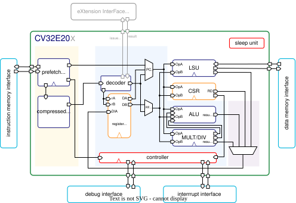
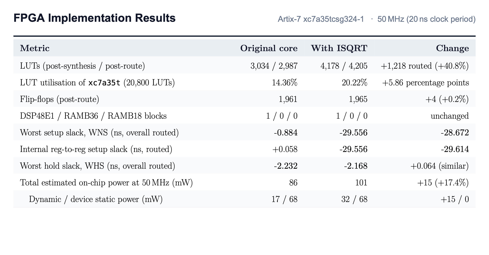
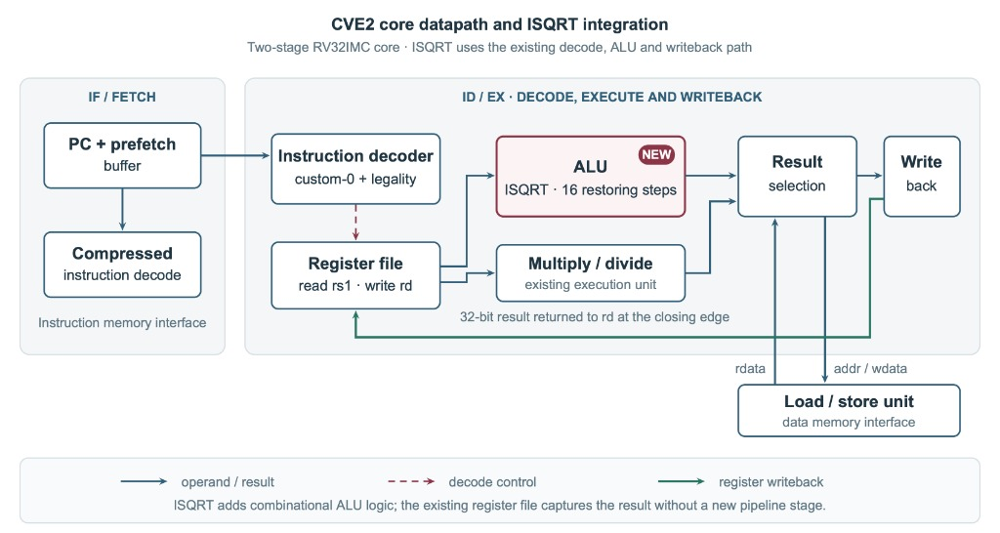
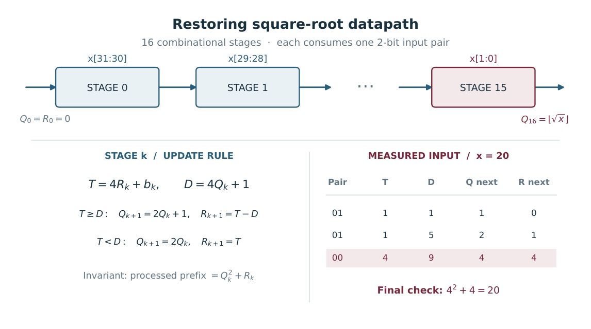
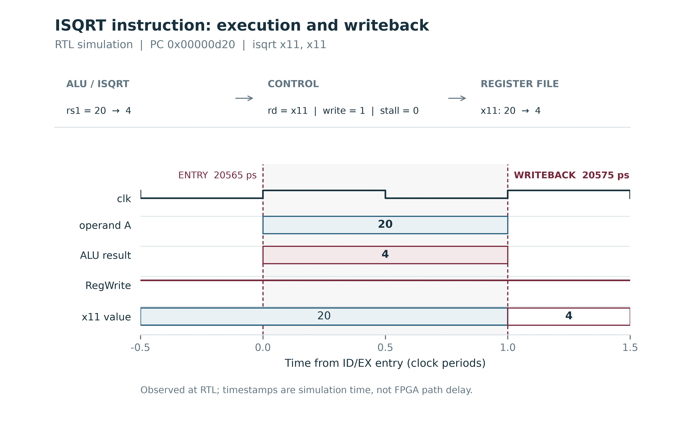
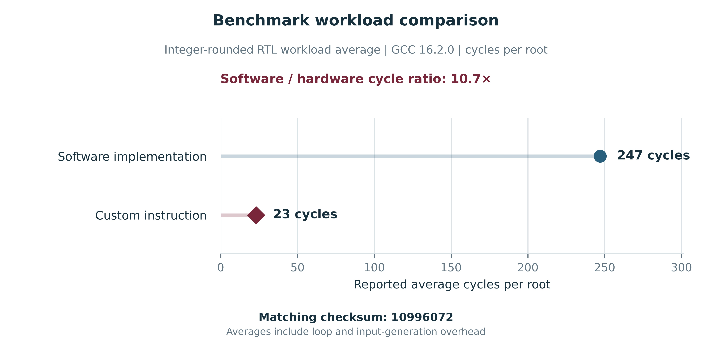
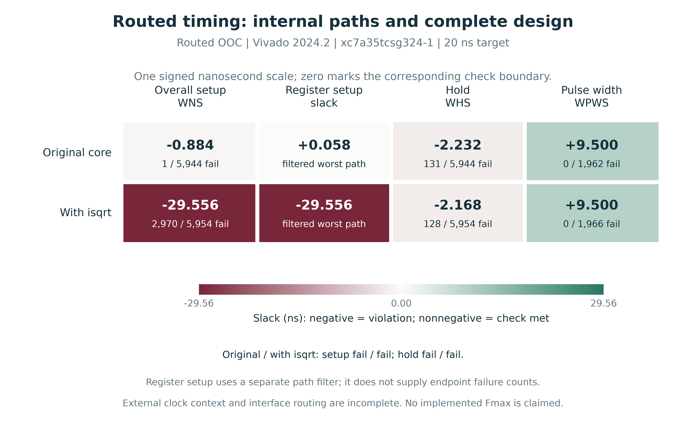
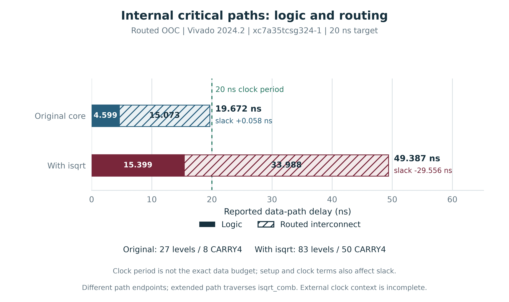
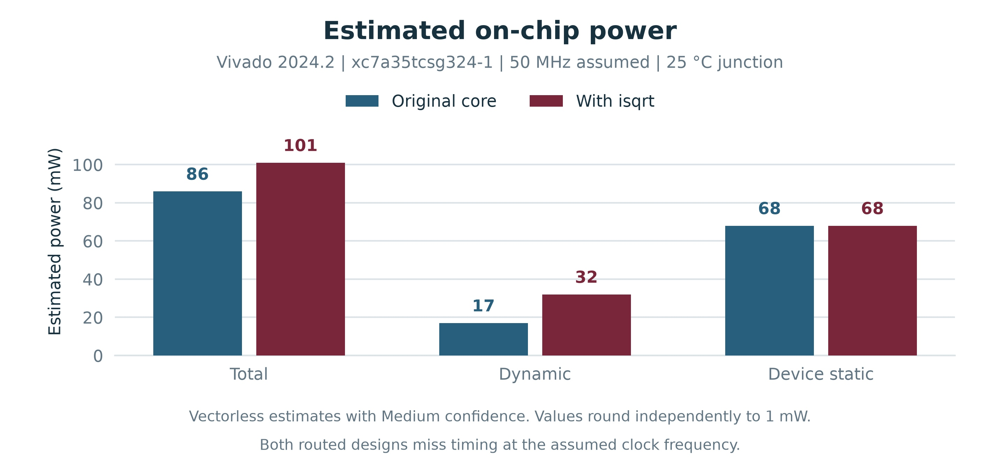

# Custom Integer Square-Root (ISQRT) Instruction for CVE2

An unsigned 32-bit integer square-root hardware instruction added to **CVE2**, an open-source 2-stage RV32IMC processor core.

[](https://doi.org/10.13140/RG.2.2.30489.79204)
[](https://ahmedez-zouine.github.io/cve2-custom-isa-extension/)
[](https://ahmedez-zouine.github.io/cve2-custom-isa-extension/showcase.html)
[](LICENSE)

<p align="center">
  <a href="docs/assets/cve2-core-blockdiagram.svg">
    
  </a>
</p>
<p align="center">
  <em>Figure 1: Full-core block diagram. ISQRT executes inside the ALU and uses the existing register file and writeback path.</em>
</p>

---

## Overview

Calculating integer square roots in software on an embedded microcontroller typically requires dozens to hundreds of clock cycles per root. This project explores what happens when you replace that software loop with a dedicated hardware instruction:

- **Instruction**: `isqrt rd, rs1` computes $r = \lfloor \sqrt{x} \rfloor$ for a 32-bit unsigned integer $x$ in register `rs1` and writes the 16-bit zero-extended result into `rd`.
- **Implementation**: Unrolls 16 restoring recurrence steps combinationally inside the ALU within the processor's existing Decode/Execute (ID/EX) stage.
- **Speedup**: The average cost per root dropped from **247 to 23 clock cycles** on a 256-input benchmark array (**10.7× faster**, including loop and test overhead).
- **Correctness**: Fully verified in simulation with over **200,000 checks**, covering random inputs, boundary values, zero registers, chained dependencies, and illegal encodings.
- **FPGA Cost**: On an AMD Xilinx Artix-7 (`xc7a35tcsg324-1`), core area increased by **+1,218 LUTs (+40.8%)**, and the long unrolled logic chain (49.4 ns data path) missed our 50 MHz timing target.

> **Technical Report**: The complete derivation, microarchitectural details, and physical FPGA evaluation are published on [ResearchGate (DOI: 10.13140/RG.2.2.30489.79204)](https://doi.org/10.13140/RG.2.2.30489.79204). You can also browse the full interactive documentation on the [Project Website](https://ahmedez-zouine.github.io/cve2-custom-isa-extension/).

---

## Key Results at a Glance

The table below summarizes post-synthesis and post-routing results on an AMD Xilinx Artix-7 FPGA at a 50 MHz (20 ns) clock constraint:

<p align="center">
  <a href="docs/assets/table3_fpga_comparison.jpg">
    
  </a>
</p>
<p align="center">
  <em>Figure 2: Physical FPGA implementation summary (Table 3: Artix-7 xc7a35tcsg324-1, Vivado 2024.2).</em>
</p>

| Metric | Original CVE2 | With ISQRT | Difference |
| :--- | :---: | :---: | :---: |
| **Benchmark latency (cycles/root)** | 247 | 23 | **10.7× faster** |
| **Post-route LUTs** | 2,987 | 4,205 | +1,218 (+40.8%) |
| **LUT utilization (Artix-7 xc7a35t)** | 14.36% | 20.22% | +5.86 pp |
| **Flip-flops (post-route)** | 1,961 | 1,965 | +4 (+0.2%) |
| **DSP48 / RAMB blocks** | 1 / 0 | 1 / 0 | unchanged |
| **Worst setup slack (WNS, 50 MHz)** | −0.884 ns | −29.556 ns | −28.672 ns |
| **Total on-chip power (vectorless)** | 86 mW | 101 mW | +15 mW (+17.4%) |

---

## Instruction Encoding

The instruction uses the RISC-V **custom-0** standard space (`opcode = 0001011` / `0x0b`):

```text
 31          25 24        20 19        15 14   12 11        7 6           0
┌──────────────┬────────────┬────────────┬───────┬───────────┬─────────────┐
│   0000000    │   00000    │    rs1     │  000  │    rd     │   0001011   │
└──────────────┴────────────┴────────────┴───────┴───────────┴─────────────┘
    funct7         rs2       src register funct3  dest reg     custom-0
```

- **Mnemonic**: `isqrt rd, rs1`
- **Operands**: `rs1` holds the 32-bit unsigned source operand. `rd` receives the 16-bit root (zero-extended to 32 bits).
- **Legality**: `funct7 = 0000000`, `rs2 = 00000`, and `funct3 = 000` are reserved specifically for `isqrt`. Any other combination in the custom-0 space raises an **illegal instruction trap**.
- **Standard semantics**: If `rd = x0`, the result is safely discarded. If `rd = rs1`, the source register is read first and updated in-place at the clock edge.

---

## Microarchitecture & Pipeline Integration

CVE2 is a compact 2-stage in-order RISC-V processor:
1. **IF (Instruction Fetch)**: Fetches 32-bit instructions or expands 16-bit compressed instructions (RVC).
2. **ID / EX (Decode, Execute & Writeback)**: Decodes instructions, reads source registers, computes results in the ALU or multiplier/divider, and writes back to the register file at the closing clock edge.

<p align="center">
  <a href="docs/assets/pipeline.jpg">
    
  </a>
</p>
<p align="center">
  <em>Figure 3: CVE2 pipeline datapath showing ISQRT integrated into the ALU within the ID/EX stage.</em>
</p>

Because CVE2 writes back at the closing edge of the ID/EX stage without a separate pipeline buffer, `isqrt` integrates seamlessly into the existing result multiplexer:
- No extra pipeline registers or stall logic required.
- Load/Store Unit (LSU) and Multiply/Divide units operate unchanged.
- The destination register captures the 16-bit root at the end of the clock period.

---

## Arithmetic Algorithm: 16-Step Restoring Recurrence

The hardware computes the square root using the digit-by-digit restoring algorithm. Because each base-4 step processes 2 input bits to produce 1 bit of the root, a 32-bit input requires **16 unrolled steps**:

<p align="center">
  <a href="docs/assets/recurrence.jpg">
    
  </a>
</p>
<p align="center">
  <em>Figure 4: Unrolled 16-step restoring recurrence with worked example for input 20.</em>
</p>

For step $i$ ($i = 15$ down to $0$):
1. **Candidate remainder**: $T = 4R + b_i$, where $b_i$ is the next 2-bit pair of the input.
2. **Trial subtractor**: $D = 4Q + 1$, where $Q$ is the root accumulated so far.
3. **Decision**:
   - If $T \geq D$: the next root bit is `1`, update $Q' = 2Q + 1$, and remainder $R' = T - D$.
   - If $T < D$: the next root bit is `0`, update $Q' = 2Q$, and remainder $R' = T$.

This mathematical formulation guarantees the invariant $P = Q^2 + R$ with $0 \le R < 2Q + 1$ at every step.

---

## Verification & Simulation

Verification was performed in Verilator and models the complete RTL down to clock-edge register writes:

<p align="center">
  <a href="docs/assets/fig03_writeback.jpg">
    
  </a>
</p>
<p align="center">
  <em>Figure 5: Simulation waveform of isqrt a1, a1 reading 20 and writing 4 at the rising clock edge without pipeline stalls.</em>
</p>

### Workload Latency Benchmark

Processing an array of 256 representative 32-bit test vectors demonstrates the speedup of the hardware instruction compared to a software routine:

<p align="center">
  <a href="docs/assets/fig04_benchmark.jpg">
    
  </a>
</p>
<p align="center">
  <em>Figure 6: Average cycles per square root: 247 cycles in software vs. 23 cycles with the ISQRT instruction (10.7× faster).</em>
</p>

### Test Suite Summary

1. **`sw_isqrt`**: Reference software implementation running on the simulated core. Produces benchmark baseline (average 247 cycles/root).
2. **`hw_isqrt`**: Direct hardware validation against 2,000 randomized 32-bit integers, plus edge cases ($0, 1, 2^{32}-1$).
3. **`isqrt_corners`**: Rigorous check of corner conditions:
   - Destination register $x0$ discarding result.
   - In-place updates (`isqrt a0, a0`).
   - Exception handling: checks that invalid `funct7`, `funct3`, or `rs2` fields trigger an illegal instruction trap and resume execution cleanly.
4. **`isqrt_integration`**: Exhaustive verification across 200,000+ pseudo-random values and square-boundary transitions ($k^2 - 1$, $k^2$, $k^2 + 1$).

---

## FPGA Timing & Physical Analysis

Synthesis and place-and-route were carried out on an AMD Xilinx Artix-7 (`xc7a35tcsg324-1`) target using Vivado 2024.2 under a 50 MHz (20 ns) clock constraint.

### Routed Timing Slack Heatmap

<p align="center">
  <a href="docs/assets/fig10_routed_timing.jpg">
    
  </a>
</p>
<p align="center">
  <em>Figure 7: Routed timing slack heatmap: overall setup (WNS), internal register-to-register setup, hold (WHS), and pulse width.</em>
</p>

### Critical Path Delay Breakdown

The unrolled 16-step restoring chain creates a long combinational path across the ALU that misses the 50 MHz timing constraint:

<p align="center">
  <a href="docs/assets/fig11_routed_path_delay.jpg">
    
  </a>
</p>
<p align="center">
  <em>Figure 8: Internal register setup path delay: logic delay (43.1 ns) dominates over net routing delay (6.3 ns) across the 16 unrolled steps.</em>
</p>

### On-Chip Power Consumption

Vectorless power estimation at 50 MHz and 25 °C junction temperature reveals an expected moderate increase in dynamic power with device static power unchanged:

<p align="center">
  <a href="docs/assets/power.jpg">
    
  </a>
</p>
<p align="center">
  <em>Figure 9: Estimated on-chip power consumption: total power grows from 86 mW to 101 mW (+17.4%), driven by dynamic switching (+15 mW).</em>
</p>

---

## Design Trade-off: Combinational vs. Iterative

The trade-off between combinational and iterative architectures was the key architectural takeaway of this study:

- **Combinational (implemented)**:
  - *Pros*: Single-cycle latency, simple control, zero pipeline stalls.
  - *Cons*: Heavy area (+40.8% LUTs) and long critical path (49.4 ns logic chain), limiting the maximum clock frequency to ~20 MHz on Artix-7.
- **16-Cycle Iterative (proposed)**:
  - *Concept*: Reuses a single restoring stage across 16 clock cycles, stalling the pipeline or running in the background.
  - *Trade-off*: Slashes area overhead down to ~150-200 LUTs and easily meets a 50-100 MHz clock target, at the cost of 16-cycle instruction latency.

See the [Design Alternatives Guide](https://ahmedez-zouine.github.io/cve2-custom-isa-extension/alternatives/) on the website for detailed formulas and timing analysis.

---

## Quickstart: How to Build & Run

### Prerequisites

- **Mac (Apple Silicon)**:
  ```sh
  brew install verilator riscv64-elf-gcc make
  ```
- **Ubuntu / Debian**:
  ```sh
  sudo apt-get install verilator gcc-riscv64-unknown-elf make
  ```

### Running Simulation Tests

Clone the repository and run the test suite:

```sh
# Run the hardware instruction test (2,007 checks)
make run TEST=hw_isqrt RISCV=riscv64-elf-

# Run corner cases and illegal encoding trap tests (43 checks)
make run TEST=isqrt_corners RISCV=riscv64-elf-

# Run full integration test (200,705 checks)
make run TEST=isqrt_integration RISCV=riscv64-elf-
```

*(On Linux, use `RISCV=riscv64-unknown-elf-` or omit if already on your `$PATH`).*

### Preview the Website Locally

The documentation site is built using [Zensical](https://github.com/zensical/zensical):

```sh
python3 -m pip install -r requirements-docs.txt
zensical serve
```

Then open `http://localhost:8000` in your browser.

---

## Project Structure

```text
├── cve2/                    # Core RTL (SystemVerilog)
│   └── rtl/
│       ├── cve2_alu.sv      # ALU with 16-step unrolled ISQRT logic
│       ├── cve2_decoder.sv  # Custom-0 decode & legality validation
│       └── cve2_pkg.sv      # Opcode & ALU operation type definitions
├── sw/                      # Test programs (C & assembly)
│   ├── hw_isqrt.c           # Hardware test (2,000 random inputs)
│   ├── sw_isqrt.c           # Software benchmark reference
│   ├── isqrt_corners.c      # Edge cases, x0 register, trap recovery
│   └── isqrt_integration.c  # Large-scale randomized validation
├── docs/                    # Documentation website sources
│   ├── assets/              # Architecture diagrams, figures, and report PDF
│   ├── index.md             # Overview page
│   ├── design.md            # Microarchitecture guide
│   ├── arithmetic.md        # Mathematical algorithm & recurrence
│   ├── results.md           # FPGA physical synthesis & routing results
│   └── alternatives.md      # Combinational vs. iterative trade-offs
├── rapport/                 # Technical report (LaTeX source & figures)
└── README.md
```

---

## Citation & Technical Report

If you reference this work or build upon this custom extension, please cite:

```bibtex
@techreport{ezzouine2026isqrt,
  author      = {Ahmed Ez-Zouine},
  title       = {An Integer Square-Root Instruction for the CVE2 RISC-V Core: Algorithm, RTL Integration, and FPGA Evaluation},
  institution = {Mohammed V University in Rabat (UM5R)},
  year        = {2026},
  doi         = {10.13140/RG.2.2.30489.79204},
  url         = {https://ahmedez-zouine.github.io/cve2-custom-isa-extension/}
}
```

- **Preprint DOI**: [10.13140/RG.2.2.30489.79204](https://doi.org/10.13140/RG.2.2.30489.79204)
- **Interactive Documentation**: [https://ahmedez-zouine.github.io/cve2-custom-isa-extension/](https://ahmedez-zouine.github.io/cve2-custom-isa-extension/)
- **Author**: Ahmed Ez-Zouine : Mohammed V University in Rabat (UM5R) ([ahmed.ezzouine@um5r.ac.ma](mailto:ahmed.ezzouine@um5r.ac.ma))

---

## License

This project is licensed under the **Apache License, Version 2.0** : see the [LICENSE](LICENSE) file for the full text.

The underlying CVE2 processor core is open-source hardware developed by the OpenHW Group / lowRISC under the Apache 2.0 license.
