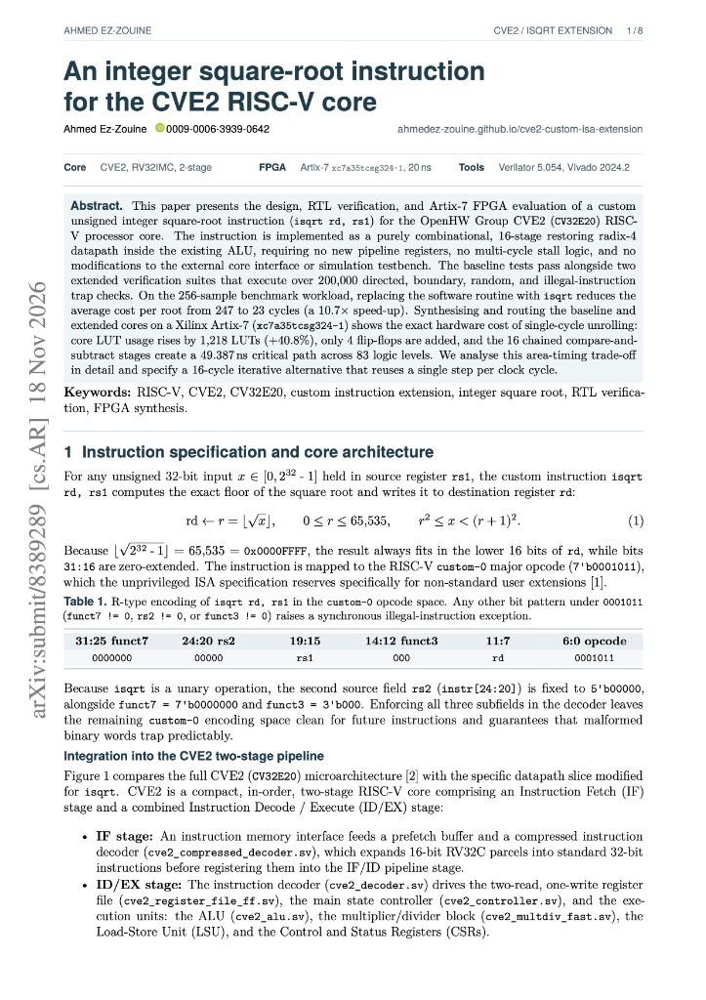
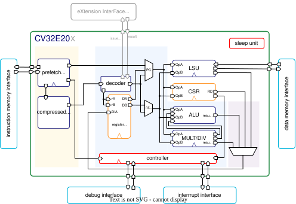
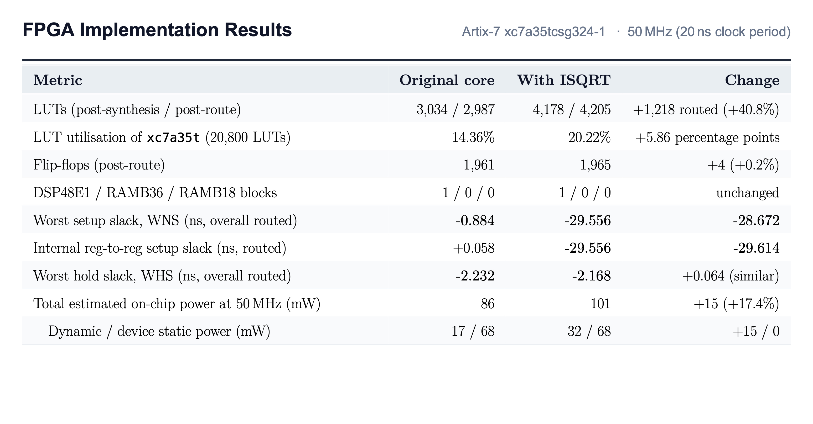
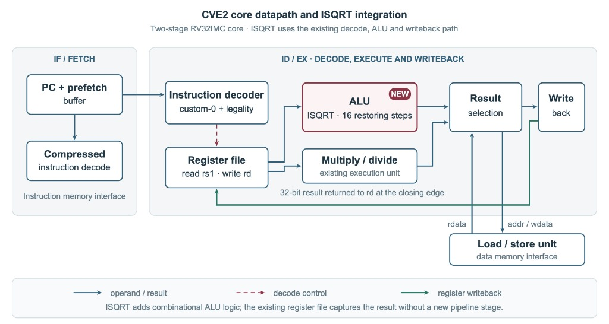
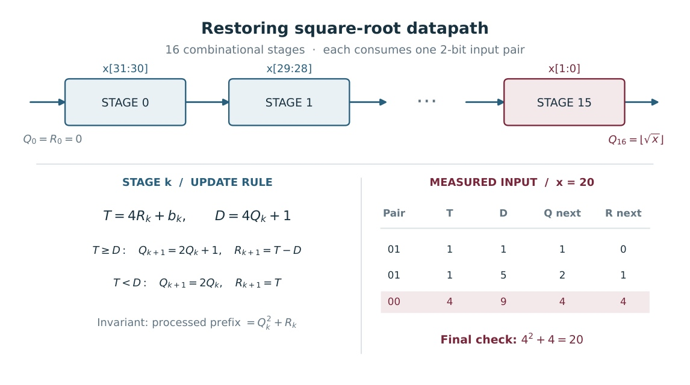
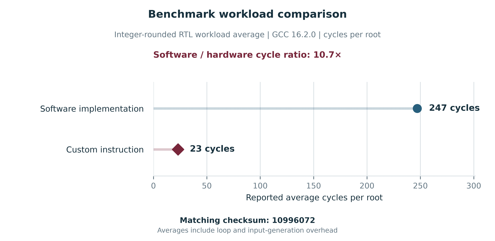

# Custom Integer Square-Root (ISQRT) Instruction for CVE2

An unsigned 32-bit integer square-root hardware instruction (`isqrt rd, rs1`) added to **CVE2**, an open-source 2-stage RV32IMC RISC-V processor core.

<p align="center">
  <a href="https://doi.org/10.13140/RG.2.2.30837.13281"></a>
  <a href="docs/assets/Ez-Zouine_CVE2_ISQRT_Technical_Report.pdf"></a>
  <a href="https://github.com/ahmedez-zouine/cve2-custom-isa-extension/actions/workflows/verify.yml"></a>
  <a href="sw/isqrt_integration.c"></a>
  <a href="https://ahmedez-zouine.github.io/cve2-custom-isa-extension/"></a>
  <a href="LICENSE"></a>
</p>

<p align="center">
  <a href="docs/assets/Ez-Zouine_CVE2_ISQRT_Technical_Report.pdf">
    
  </a>
</p>
<p align="center">
  <em>Technical paper submitted to arXiv (cs.AR submit/8389289) and published on ResearchGate. Click to open the 8-page PDF report.</em>
</p>

<p align="center">
  <a href="docs/assets/cve2-core-blockdiagram.svg">
    
  </a>
</p>
<p align="center">
  <em>Figure 1: Full-core block diagram. The ISQRT datapath executes inside the ALU using the existing register file and writeback bus.</em>
</p>

---

## Executive Summary

- **Instruction**: `isqrt rd, rs1` computes $r = \lfloor \sqrt{x} \rfloor$ for an unsigned 32-bit integer in register `rs1` and writes the 16-bit zero-extended result to `rd`.
- **Microarchitecture**: Unrolled 16-stage restoring radix-4 datapath inside the ALU (ID/EX stage), requiring zero extra pipeline registers or stall logic.
- **Speedup**: Average latency drops from **247 to 23 cycles per root** on a 256-input benchmark array (**10.7x faster**).
- **RTL Verification**: 100% passing across **200,705 checks** in Verilator (random, boundary, corner cases, and illegal instruction traps).
- **FPGA Cost**: On AMD Xilinx Artix-7 (`xc7a35t`), area increases by **+1,218 LUTs (+40.8%)**, with a 49.4 ns critical path that misses 50 MHz timing.

---

## Key Results (Artix-7 FPGA @ 50 MHz)

Post-synthesis and post-routing results on an AMD Xilinx Artix-7 FPGA (`xc7a35tcsg324-1`) at 50 MHz (20 ns clock constraint):

<p align="center">
  <a href="docs/assets/table3_fpga_comparison.jpg">
    
  </a>
</p>
<p align="center">
  <em>Figure 2: Physical FPGA implementation summary (Table 3: Artix-7 xc7a35tcsg324-1, Vivado 2024.2).</em>
</p>

| Metric | Original CVE2 | With ISQRT | Impact |
| :--- | :---: | :---: | :---: |
| **Benchmark latency** | 247 cycles/root | 23 cycles/root | **10.7x faster** |
| **Post-route LUTs** | 2,987 | 4,205 | +1,218 (+40.8%) |
| **LUT utilization (xc7a35t)** | 14.36% | 20.22% | +5.86 pp |
| **Flip-flops (post-route)** | 1,961 | 1,965 | +4 (+0.2%) |
| **DSP48 / BRAM blocks** | 1 / 0 | 1 / 0 | 0 overhead |
| **Worst setup slack (WNS)** | -0.884 ns | -29.556 ns | Critical path: 49.4 ns |
| **Total on-chip power** | 86 mW | 101 mW | +15 mW dynamic (+17.4%) |

> **Trade-off Note**: The single-cycle combinational approach provides maximum throughput. For clock-constrained designs (50-100 MHz), a 16-cycle iterative multicycle unit is analyzed in Section 6 of the paper.

---

## Pipeline & Datapath Integration

CVE2 is a compact 2-stage in-order core (IF and ID/EX). Because results write back at the closing edge of the ID/EX stage, `isqrt` integrates directly into the ALU multiplexer without extra pipeline control:

<p align="center">
  <a href="docs/assets/pipeline.jpg">
    
  </a>
</p>
<p align="center">
  <em>Figure 3: CVE2 pipeline datapath showing the single-cycle ISQRT logic in the ID/EX stage.</em>
</p>

---

## Arithmetic Algorithm: 16-Step Restoring Recurrence

The custom instruction unrolls a digit-by-digit restoring recurrence across 16 stages (radix-4), processing 2 input bits per stage to yield a 16-bit root while preserving the invariant $P = Q^2 + R$:

<p align="center">
  <a href="docs/assets/recurrence.jpg">
    
  </a>
</p>
<p align="center">
  <em>Figure 4: Unrolled 16-step restoring recurrence with worked example for input 20.</em>
</p>

---

## Performance: 10.7x Benchmark Speedup

Replacing the software integer square-root routine with the hardware instruction slashes average root computation from 247 cycles to 23 cycles per root:

<p align="center">
  <a href="docs/assets/fig04_benchmark.jpg">
    
  </a>
</p>
<p align="center">
  <em>Figure 5: Average cycles per root on a 256-sample workload (10.7x speedup including loop overhead).</em>
</p>

---

## Instruction Encoding

Encoded in the standard RISC-V **custom-0** opcode space (`0x0b` / `7'b0001011`):

```text
 31          25 24        20 19        15 14   12 11        7 6           0
┌──────────────┬────────────┬────────────┬───────┬───────────┬─────────────┐
│   0000000    │   00000    │    rs1     │  000  │    rd     │   0001011   │
└──────────────┴────────────┴────────────┴───────┴───────────┴─────────────┘
    funct7         rs2          src1      funct3      dest       custom-0
```

- Any malformed encoding under `custom-0` synchronously triggers an **illegal instruction trap**.
- Writing to register `x0` safely discards the result; in-place operations (`isqrt a0, a0`) update cleanly at the clock edge.

---

## Technical Paper & Documentation

- **Preprint DOI**: [10.13140/RG.2.2.30837.13281](https://doi.org/10.13140/RG.2.2.30837.13281)
- **arXiv Submission**: `submit/8389289` (`cs.AR` - Hardware Architecture)
- **Direct PDF**: [Ez-Zouine_CVE2_ISQRT_Technical_Report.pdf](docs/assets/Ez-Zouine_CVE2_ISQRT_Technical_Report.pdf) (8 pages, single-column)
- **Interactive Website**: [https://ahmedez-zouine.github.io/cve2-custom-isa-extension/](https://ahmedez-zouine.github.io/cve2-custom-isa-extension/)

---

## Quickstart: Simulation & Verification

### Prerequisites
* **macOS**: `brew install verilator riscv64-elf-gcc make`
* **Linux (Ubuntu/Debian)**: `sudo apt-get install verilator gcc-riscv64-unknown-elf make`

### Run Verilator Tests
```sh
# Basic hardware instruction validation (2,007 checks)
make run TEST=hw_isqrt RISCV=riscv64-elf-

# Corner cases and illegal encoding trap tests (43 checks)
make run TEST=isqrt_corners RISCV=riscv64-elf-

# Full randomized integration verification (200,705 checks)
make run TEST=isqrt_integration RISCV=riscv64-elf-
```
*(On Linux, use `RISCV=riscv64-unknown-elf-` or omit if the toolchain is already on your `$PATH`.)*

---

## Citation

```bibtex
@techreport{ezzouine2026isqrt,
  author      = {Ahmed Ez-Zouine},
  title       = {An Integer Square-Root Instruction for the CVE2 RISC-V Core: Algorithm, RTL Integration, and FPGA Evaluation},
  institution = {Independent Research},
  year        = {2026},
  doi         = {10.13140/RG.2.2.30837.13281},
  url         = {https://ahmedez-zouine.github.io/cve2-custom-isa-extension/}
}
```

**Author**: Ahmed Ez-Zouine : Independent Researcher ([ahmed.ezzouine@um5r.ac.ma](mailto:ahmed.ezzouine@um5r.ac.ma))

---

<div align="center">

## Global Visitors

*Visitor activity across multi-architecture computing research hubs*

<a href="https://mapmyvisitors.com/web/1c9ip" target="_blank" rel="noopener">
  
</a>

</div>

---

## License

This project is licensed under the **Apache License, Version 2.0**: see the [LICENSE](LICENSE) file.  
The base CVE2 processor core is open-source hardware developed by OpenHW Group / lowRISC under the Apache 2.0 license.
