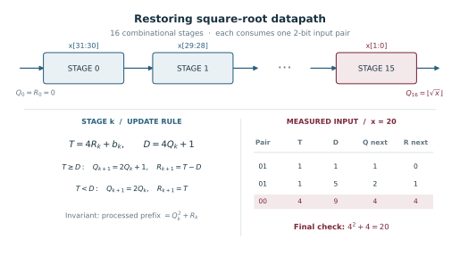

# How integer square root works

For an unsigned input *n*, the result *q* satisfies **q² ≤ n < (q + 1)²**. For a 32-bit input, the result fits in 16 bits. The largest possible input is 4,294,967,295, and the next square after 65,535² is 65,536² = 4,294,967,296.
{ .project-lead }

## Why the algorithm reads two bits at a time

Appending a pair of binary digits with value *b* to a prefix *P* gives **P′ = 4P + b**, where *b* is 0, 1, 2 or 3. Multiplying the prefix by four doubles its square root. Since q² ≤ P < (q + 1)² and *P* is an integer, the next prefix lies between (2q)² inclusive and (2q + 2)² exclusive. Its integer root is therefore either **2q** or **2q + 1**.

## How the next root bit is chosen

Keep the remainder *r* such that **P = q² + r**. The new prefix and the gap between the two candidate squares are:

  
P′ = 4P + b = (2q)² + (4r + b)

  
(2q + 1)² − (2q)² = 4q + 1

Call **T = 4r + b** the shifted remainder and **D = 4q + 1** the trial value. When T ≥ D, append a one to the root and keep T − D as the new remainder. Otherwise append a zero and keep T. Either choice preserves P′ = q′² + r′ and 0 ≤ r′ ≤ 2q′, so the same rule applies to the next pair.

## Worked example for 20

Start with q = 0 and r = 0. The 32-bit representation of 20 ends in the pairs `01 01 00`. The first 13 pairs are zero and leave the root and remainder at zero.

| Pair | Prefix P′ | T = 4r + b | D = 4q + 1 | Root bit | New root q′ | New remainder r′ |
| --- | ---: | ---: | ---: | ---: | ---: | ---: |
| `01` | 1 | 1 | 1 | 1 | 1 | 0 |
| `01` | 5 | 1 | 5 | 0 | 2 | 1 |
| `00` | 20 | 4 | 9 | 0 | 4 | 4 |

The root bits `100` give **4**. The remainder is 20 − 4² = **4**, and 20 lies below 5² = 25.

## Try a 32-bit input

Enter a whole number from 0 to 4,294,967,295. The table shows the pairs in the order the ALU processes them.

<section class="isqrt-explorer" hidden>
  <form id="isqrt-form">
    <label for="isqrt-input">Unsigned input</label>
    

      <input id="isqrt-input" type="text" inputmode="numeric" pattern="[0-9]+" value="20" required>
      <button class="md-button md-button--primary" type="submit">Calculate</button>
    

    <output for="isqrt-input" id="isqrt-result" aria-live="polite"></output>
  </form>
  

    
Show all 16 steps

    

      <table>
        <thead>
          <tr>
            <th scope="col">Step</th>
            <th scope="col">Pair</th>
            <th scope="col">Prefix P′</th>
            <th scope="col">T</th>
            <th scope="col">D</th>
            <th scope="col">Root bit</th>
            <th scope="col">Root q′</th>
            <th scope="col">Remainder r′</th>
          </tr>
        </thead>
        <tbody id="isqrt-steps"></tbody>
      </table>
    

  

</section>
<noscript>
Enable JavaScript to enter your own input. The worked example above shows the calculation for 20.
</noscript>

## How it maps to RTL

The ALU shifts two input bits into the remainder and compares it with the trial value. The shift and compare repeat for all 16 pairs. The last step supplies the result to the [normal register writeback path](design.md#pipeline-integration).

