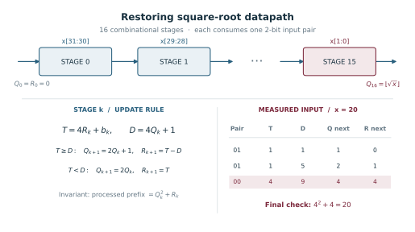

# How integer square root works

The integer square root is the largest integer whose square is at most the input. A 32-bit unsigned input gives a result from 0 to 65,535 because 65,536² exceeds the largest input.
{ .project-lead }

  <math display="block">
    <mi>q</mi><mo>=</mo><mo>⌊</mo><msqrt><mi>n</mi></msqrt><mo>⌋</mo><mo>,</mo>
    <mspace width="1em"></mspace>
    <msup><mi>q</mi><mn>2</mn></msup><mo>≤</mo><mi>n</mi><mo>&lt;</mo>
    <msup><mrow><mo>(</mo><mi>q</mi><mo>+</mo><mn>1</mn><mo>)</mo></mrow><mn>2</mn></msup>
  </math>

## Why the algorithm reads two bits at a time

Appending a pair of binary digits with value *b* to a prefix *P* gives **P′ = 4P + b**, where *b* is 0, 1, 2 or 3. Multiplying the prefix by four doubles its square root. Since q² ≤ P < (q + 1)² and *P* is an integer, the next prefix lies between (2q)² inclusive and (2q + 2)² exclusive. Its integer root is therefore either **2q** or **2q + 1**.

## How the next root bit is chosen

Keep the remainder *r* such that **P = q² + r**. The new prefix and the gap between the two candidate squares are:

  <math display="block">
    <msup><mi>P</mi><mo>′</mo></msup><mo>=</mo><mn>4</mn><mi>P</mi><mo>+</mo><mi>b</mi><mo>=</mo>
    <msup><mrow><mo>(</mo><mn>2</mn><mi>q</mi><mo>)</mo></mrow><mn>2</mn></msup>
    <mo>+</mo><mo>(</mo><mn>4</mn><mi>r</mi><mo>+</mo><mi>b</mi><mo>)</mo>
  </math>
  <math display="block">
    <msup><mrow><mo>(</mo><mn>2</mn><mi>q</mi><mo>+</mo><mn>1</mn><mo>)</mo></mrow><mn>2</mn></msup>
    <mo>−</mo>
    <msup><mrow><mo>(</mo><mn>2</mn><mi>q</mi><mo>)</mo></mrow><mn>2</mn></msup>
    <mo>=</mo><mn>4</mn><mi>q</mi><mo>+</mo><mn>1</mn>
  </math>

Call **T = 4r + b** the shifted remainder and **D = 4q + 1** the trial value. When T ≥ D, append a one to the root and keep T − D as the new remainder. Otherwise append a zero and keep T. Either choice preserves P′ = q′² + r′ and 0 ≤ r′ ≤ 2q′, so the same rule applies to the next pair.

## Worked example for 20

Start with q = 0 and r = 0. The 32-bit representation of 20 ends in the pairs `01 01 00`. The first 13 pairs are zero and leave the root and remainder at zero.

  <table class="project-data project-trace project-worked">
    <thead>
      <tr>
        <th scope="col">Step</th>
        <th scope="col">Pair</th>
        <th scope="col">T vs D</th>
        <th scope="col">Bit</th>
        <th scope="col">Root</th>
        <th scope="col">Remainder</th>
      </tr>
    </thead>
    <tbody>
      <tr><th scope="row">14</th><td><code>01</code></td><td>1 = 1</td><td>1</td><td>1</td><td>0</td></tr>
      <tr><th scope="row">15</th><td><code>01</code></td><td>1 &lt; 5</td><td>0</td><td>2</td><td>1</td></tr>
      <tr><th scope="row">16</th><td><code>00</code></td><td>4 &lt; 9</td><td>0</td><td>4</td><td>4</td></tr>
    </tbody>
  </table>

At step 14, the shifted remainder equals the trial, so the algorithm accepts the subtraction and writes a one. The next two subtractions would go below zero, so each adds a zero bit. The resulting bits `100` give **4**, with a remainder of **4**.

## Interactive hardware execution demo { .project-section }

Enter an unsigned 32-bit integer (0 to 4,294,967,295), choose a preset, or step through the 16 combinational stages (`p15` down to `p0`) to inspect how `cve2_alu` resolves each root bit.

<section class="isqrt-explorer" hidden>
  

    <form id="isqrt-form" class="isqrt-form-bar">
      <label for="isqrt-input"><strong>Input operand (rs1):</strong></label>
      

        <input id="isqrt-input" type="text" inputmode="numeric" pattern="[0-9, ]+" value="2086479684" required aria-label="Unsigned 32-bit integer">
        <button class="md-button md-button--primary" type="submit">Compute</button>
      

    </form>
    

      Presets:
      <button type="button" class="preset-chip" data-value="20">20 (Report)</button>
      <button type="button" class="preset-chip" data-value="144">144</button>
      <button type="button" class="preset-chip" data-value="65535">65,535</button>
      <button type="button" class="preset-chip" data-value="1000000">1,000,000</button>
      <button type="button" class="preset-chip" data-value="2086479684">2,086,479,684 (45,678²)</button>
      <button type="button" class="preset-chip" data-value="4294967295">Max UINT32</button>
    

  

  <output for="isqrt-input" id="isqrt-result" class="isqrt-summary-bar" aria-live="polite"></output>

  

    

      <strong>16 Bit-Pair Register Strip</strong>
      Stage 16 / 16
    

    

      <button type="button" class="md-button" id="isqrt-prev" title="Previous stage">◀ Prev</button>
      <button type="button" class="md-button md-button--primary" id="isqrt-play" title="Animate stages 1 to 16">▶ Play 16 Stages</button>
      <button type="button" class="md-button" id="isqrt-next" title="Next stage">Next ▶</button>
    

  

  

  

  

    
All 16 combinational stages (click any row to inspect stage)

    

      <table class="project-data project-trace">
        <thead>
          <tr>
            <th scope="col">Step</th>
            <th scope="col">Pair (b)</th>
            <th scope="col">Prefix (P)</th>
            <th scope="col">Candidate (T)</th>
            <th scope="col">Trial (D)</th>
            <th scope="col">Root Bit</th>
            <th scope="col">Partial Root (Q)</th>
            <th scope="col">Remainder (R)</th>
          </tr>
        </thead>
        <tbody id="isqrt-steps"></tbody>
      </table>
    

  

</section>
<noscript>
Enable JavaScript to enter your own input. The worked example above shows the calculation for 20.
</noscript>

## How it maps to RTL

The ALU shifts two input bits into the remainder and compares it with the trial value. The shift and compare repeat for all 16 pairs. The last step supplies the result to the [normal register writeback path](design.md#decode-execute-and-write-back).

<figure class="project-compact-figure">
  
</figure>
