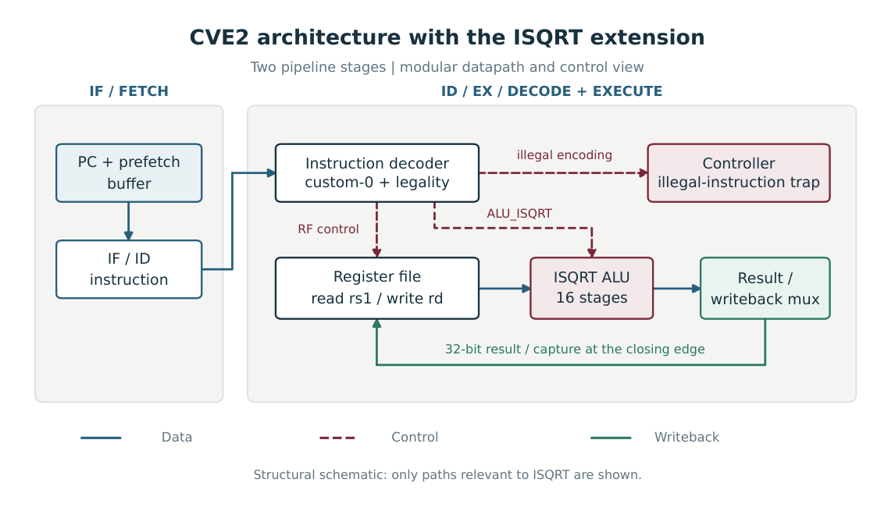
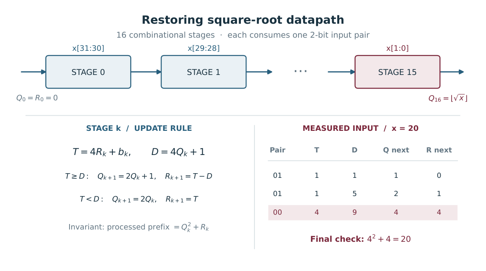

# Design

`isqrt rd, rs1` returns `floor(sqrt(rs1))`. The operand is unsigned, and the result ranges from 0 to 65,535. The instruction writes the result as a zero-extended 32-bit value.

## Instruction encoding

| Bits | Field | Value |
| --- | --- | --- |
| 31–25 | `funct7` | `0000000` |
| 24–20 | `rs2` | `00000` |
| 19–15 | `rs1` | Source register |
| 14–12 | `funct3` | `000` |
| 11–7 | `rd` | Destination register |
| 6–0 | Opcode | `0001011` (`0x0b`, custom-0) |

The decoder accepts the instruction only when `funct7`, `rs2` and `funct3` all encode zero. The ordinary illegal-instruction path handles the other custom-0 encodings. The existing register file handles `rd = rs1` and `rd = x0`.

## Pipeline integration

The decoder reads `rs1`, selects `ALU_ISQRT` and enables the normal register write. The ALU computes the result from operand A. The result mux sends it to the existing writeback path.

| Source file | Change |
| --- | --- |
| [`cve2_pkg.sv`](https://github.com/ahmedez-zouine/cve2-custom-isa-extension/blob/10f4bd0/cve2/rtl/cve2_pkg.sv) | Defines the custom opcode and ALU operation |
| [`cve2_decoder.sv`](https://github.com/ahmedez-zouine/cve2-custom-isa-extension/blob/10f4bd0/cve2/rtl/cve2_decoder.sv) | Checks legality and selects the operands and operation |
| [`cve2_alu.sv`](https://github.com/ahmedez-zouine/cve2-custom-isa-extension/blob/10f4bd0/cve2/rtl/cve2_alu.sv) | Computes the root and selects the result |

## Square-root datapath

Each of the 16 restoring steps consumes two input bits, starting with the most significant pair. It shifts that pair into the remainder and compares the result with `4 × root + 1`. When the subtraction fits, the step subtracts the trial value and appends a one to the root. Otherwise it appends a zero.

The current RTL unrolls the steps into combinational logic. A multicycle design could reuse one step for 16 iterations, with extra control and writeback cycles. That would trade instruction latency for less duplicated arithmetic and a shorter combinational path.
