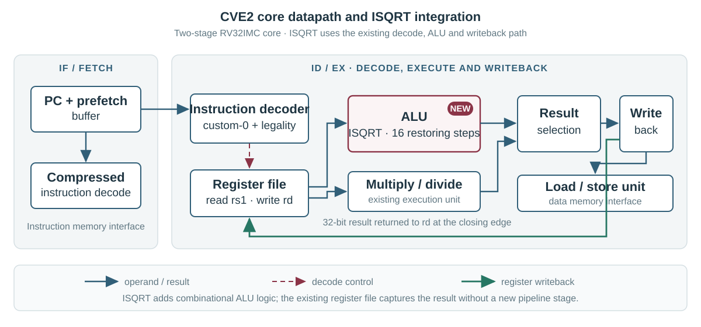

---
hide:
  - toc
description: A custom integer square-root instruction for the CVE2 RISC-V processor, with its design, verification and Artix-7 results.
---

# An integer square root, built into CVE2

The custom `isqrt rd, rs1` instruction computes the floor of the square root of a 32-bit unsigned integer. For example, `isqrt(20) = 4`, since 4² ≤ 20 < 5². CVE2 decodes the instruction, calculates the root in its ALU, then writes it to `rd` through the existing register path.
{ .project-lead }

[Explore the instruction design](design.md){ .md-button .md-button--primary }
[See the experimental results](results.md){ .md-button }

## Measured comparison { .project-section }

|  | Software reference | Custom instruction |
| --- | ---: | ---: |
| Average cycles per result | 247 | **23** |
| Routed lookup tables | 2,987 | **4,205** |
| Integration checks passed | — | **200,705** |

Both implementations processed the same 256 inputs and produced checksum 10,996,072. The displayed cycle counts are rounded workload averages. In this simulation, the custom instruction reduced the average from 247 cycles to 23. Routed lookup-table use rose by 1,218, or 40.8%. Integration tests check square boundaries, full-width inputs and dependent instructions.

## How the extension fits the processor { .project-section }

The decoder accepts the custom-0 encoding when its function fields are legal. It selects the square-root ALU operation and reads the source register. The ALU consumes two operand bits per restoring step. Sixteen steps produce the 16-bit root, which then flows through the existing result mux and writeback logic. The [arithmetic guide](arithmetic.md) derives the recurrence, and [verification](verification.md) shows a register-to-register example.

## FPGA area and timing { .project-section }

The comparison uses the same Artix-7 `xc7a35tcsg324-1` device, Vivado 2024.2 and 20 ns target for both variants. The routed extended core **does not meet that target**. Its worst register setup slack is −29.556 ns. The implementation is out of context, so the reports lack complete board clock and interface constraints.

Cycle measurements come from simulation. FPGA measurements come from synthesis and routing. The simulated cycle ratio does not predict FPGA clock frequency. [Review resources, timing and power estimates](results.md) or [reproduce the experiments](reproduce.md).

## Browse the project { .project-section }

<nav class="project-card-grid" aria-label="Project guides">
  <a class="project-card" href="design/">
    <strong>Instruction design</strong>01
    Encoding, decoding, ALU selection and writeback
  </a>
  <a class="project-card" href="arithmetic/">
    <strong>Arithmetic</strong>02
    The recurrence, worked example and input explorer
  </a>
  <a class="project-card" href="verification/">
    <strong>Verification</strong>03
    Test coverage, instruction dependencies and waveform
  </a>
  <a class="project-card" href="results/">
    <strong>FPGA results</strong>04
    Routed resources, timing and power estimates
  </a>
  <a class="project-card" href="reproduce/">
    <strong>Installation</strong>05
    Set up the tools and run the experiments
  </a>
</nav>
