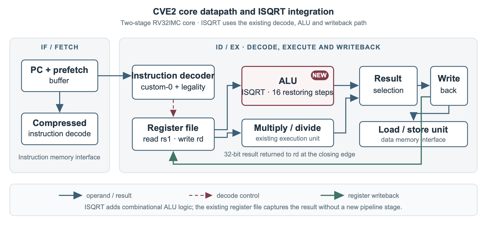
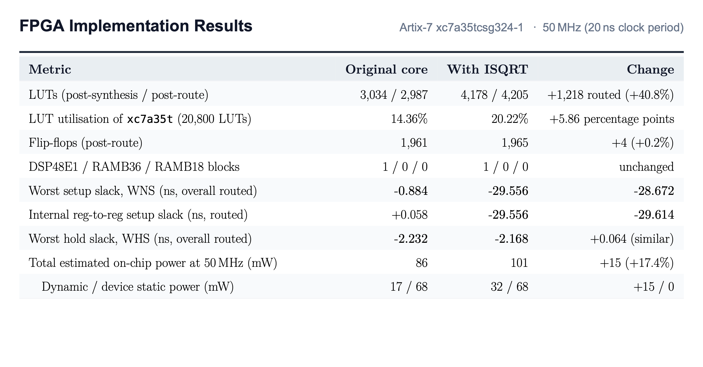
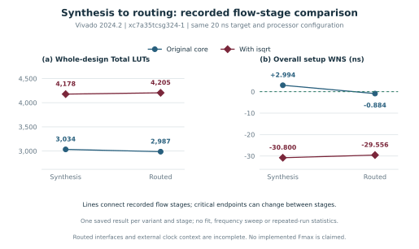

---
hide:
  - toc
description: "A custom integer square-root instruction for the CVE2 RISC-V core: design, verification and Artix-7 results."
---

# An integer square root, built into CVE2

The custom `isqrt rd, rs1` instruction computes the floor of the square root of an unsigned 32-bit integer: **q = ⌊√n⌋**. For example, **isqrt(20) = 4**, since **4² ≤ 20 < 5²**. CVE2 decodes the custom-0 instruction, evaluates the root in its ALU in one execution interval, and returns the result to `rd` through the existing register writeback path.
{ .project-lead }

  <a class="md-button md-button--primary" href="design/">Core architecture</a>
  <a class="md-button" href="arithmetic/">Arithmetic algorithm</a>
  <a class="md-button" href="results/">FPGA results</a>
  <a class="md-button" href="#technical-report">Technical report</a>

<figure class="project-figure">
  
  <figcaption>CVE2 datapath: ISQRT integrates directly into decode, the single-cycle ALU, and existing register writeback.</figcaption>
</figure>

## Measured comparison { .project-section }

| Evaluation metric | Software reference | Custom instruction (`isqrt`) |
| --- | ---: | ---: |
| Average cycles per result | 247 | **23** |
| Routed lookup tables (Artix-7) | 2,987 | **4,205** |
| Integration checks passed | — | **200,705** |

Both implementations processed the same 256-input benchmark array and produced matching checksum 10,996,072. In simulation, the custom instruction reduced the workload average from 247 cycles to 23 (about 10.7× fewer cycles). Routed lookup-table use increased by 1,218 LUTs (+40.8%). Integration tests verify square boundaries, full-width inputs, corner cases, and dependent instruction chains.

## How the extension fits the processor { .project-section }

The decoder accepts the custom-0 encoding (`0x0b`) when its function fields are legal (`funct7 = 0`, `rs2 = 0`, `funct3 = 0`). It selects the square-root ALU operation and reads the source register. The ALU processes two operand bits per restoring step; sixteen unrolled steps produce the 16-bit root, which flows through the existing result mux and writeback logic. The [arithmetic guide](arithmetic.md) derives the recurrence, and [verification](verification.md) illustrates register writeback.

<figure class="project-figure project-figure--narrow">
  
  <figcaption>Full-core context: ISQRT is implemented within the ALU and uses the existing register file and writeback path.</figcaption>
</figure>

## FPGA area and timing { .project-section }

The comparison uses the same AMD Xilinx Artix-7 `xc7a35tcsg324-1` device, Vivado 2024.2 and a 20 ns (50 MHz) target for both variants. The routed extended core does not meet that target; its worst register setup slack is −29.556 ns due to the unrolled 16-step combinational delay (49.387 ns data path). The implementation is out of context, so reports omit complete board clock and interface constraints.

<figure class="project-figure">
  
  <figcaption>Table 3: Comprehensive FPGA implementation metrics comparing baseline and ISQRT cores on Artix-7 at 50 MHz.</figcaption>
</figure>

<figure class="project-figure">
  
  <figcaption>Resource utilization and setup timing slack for baseline and extended cores after synthesis and routing.</figcaption>
</figure>

Cycle measurements come from Verilator simulation. FPGA measurements come from Vivado synthesis and routing. [Review resources, timing and power estimates](results.md) or [compare with an iterative multicycle proposal](alternatives.md).

## Documentation guides { .project-section }

<nav class="project-link-list" aria-label="Project guides">
  <a href="design/"><strong>Core architecture</strong>Encoding, decode, execution and writeback</a>
  <a href="arithmetic/"><strong>Arithmetic algorithm</strong>Recurrence, worked example and input explorer</a>
  <a href="verification/"><strong>Verification</strong>Test coverage, dependencies and waveform</a>
  <a href="results/"><strong>FPGA results</strong>Area, routed timing and power estimates</a>
  <a href="alternatives/"><strong>Design trade-offs</strong>Combinational vs iterative multicycle unit</a>
  <a href="reproduce/"><strong>Reproduction</strong>Tool setup and experiment commands</a>
</nav>

## Technical report { .project-section #technical-report }

The technical report provides the complete derivation, verification details, and physical FPGA evaluation by <strong>Ahmed Ez-Zouine</strong> (6 pages, single column, A4). Also published as a preprint on <a href="https://www.researchgate.net/publication/417821430_An_integer_square-root_instruction_for_the_CVE2_RISC-V_core" target="_blank" rel="noopener">ResearchGate</a>.

  <a class="md-button md-button--primary" href="assets/Ez-Zouine_CVE2_ISQRT_Technical_Report.pdf" download="Ez-Zouine_CVE2_ISQRT_Technical_Report.pdf">Download PDF (505 KB)</a>
  <a class="md-button" href="assets/Ez-Zouine_CVE2_ISQRT_Technical_Report.pdf" target="_blank" rel="noopener">Open in a new tab</a>
  <a class="md-button" href="https://www.researchgate.net/publication/417821430_An_integer_square-root_instruction_for_the_CVE2_RISC-V_core" target="_blank" rel="noopener">ResearchGate preprint ↗</a>

  <iframe class="paper-frame" src="assets/Ez-Zouine_CVE2_ISQRT_Technical_Report.pdf#view=FitH" title="CVE2 integer square-root technical report by Ahmed Ez-Zouine" loading="lazy"></iframe>

If the embedded paper does not appear in your browser, open the <a href="assets/Ez-Zouine_CVE2_ISQRT_Technical_Report.pdf">PDF directly</a> or read the <a href="https://www.researchgate.net/publication/417821430_An_integer_square-root_instruction_for_the_CVE2_RISC-V_core" target="_blank" rel="noopener">preprint on ResearchGate</a>.

