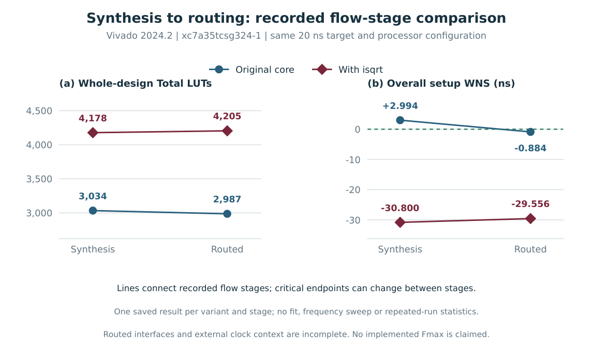

---
hide:
  - toc
description: A custom integer square-root instruction for the CVE2 RISC-V core.
---

# Integer square root for CVE2

The `isqrt` instruction computes the floor of the square root of a 32-bit unsigned integer. It uses CVE2's existing ALU and register writeback path. This project traces the change from the instruction encoding to simulation and routed FPGA results.

[See the design](design.md){ .md-button .md-button--primary }
[Compare FPGA results](results.md){ .md-button }

<dl class="project-metrics">
  
<dt>Workload cycles per root</dt><dd>247 → 23</dd>

  
<dt>Integration checks passed</dt><dd>200,705</dd>

  
<dt>Routed LUTs</dt><dd>2,987 → 4,205</dd>

</dl>

## The trade-off

The simulation benchmark gives a cycle ratio of about 10.7× in favor of the hardware version. Unrolling all 16 square-root steps into one combinational datapath increased the FPGA area and lengthened the register setup path. The extended core had **−29.556 ns** worst register setup slack at the 20 ns target.

The comparison uses an Artix-7 `xc7a35tcsg324-1` and Vivado 2024.2. The [FPGA results](results.md) give the timing and power conditions. The [verification page](verification.md) shows the simulation waveform and test coverage.
