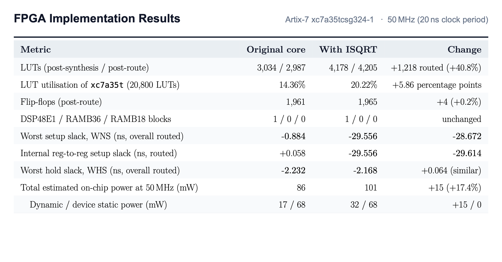
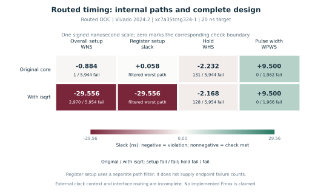
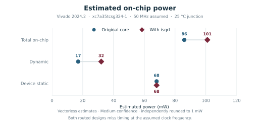

# FPGA Implementation & Physical Results

Comparative post-synthesis and post-routing implementation results for the baseline and `isqrt`-extended CVE2 cores on AMD Xilinx Artix-7 (`xc7a35tcsg324-1`) with Vivado 2024.2 under a 20 ns (50 MHz) target constraint.
{ .project-lead }

## Implementation overview

<figure class="project-figure project-figure--wide">
  
  <figcaption>Table 3: Comprehensive FPGA physical implementation comparison showing post-synthesis/route logic utilization, timing slack, and estimated power on Artix-7 at 50 MHz.</figcaption>
</figure>

## Area and cycle counts

| Metric | Original core or software | With isqrt |
| --- | ---: | ---: |
| Simulation cycles per root, workload average | 247 | 23 |
| Synthesized LUTs | 3,034 | 4,178 |
| Routed LUTs | 2,987 | 4,205 |
| Routed flip-flops | 1,961 | 1,965 |
| Routed DSP blocks | 1 | 1 |
| Routed RAMB36 / RAMB18 | 0 / 0 | 0 / 0 |

The software and hardware workloads used the same 256 inputs and produced checksum 10,996,072. Their printed, rounded averages give a cycle ratio of about 10.7×. The routed LUT increase is 1,218, or 40.8%.

## Routed timing

| Slack | Original core | With isqrt |
| --- | ---: | ---: |
| Overall setup WNS | −0.884 ns | −29.556 ns |
| Worst register setup | +0.058 ns | −29.556 ns |
| Hold WHS | −2.232 ns | −2.168 ns |

<figure class="project-compact-figure">
  
</figure>

The heatmap uses one signed scale centered on zero. Register setup is a separate register-to-register query: its +0.058 ns result for the original core does not override the −0.884 ns overall setup slack. Both designs also report hold violations.

Both designs miss overall setup and hold at the 20 ns target. The extended core's worst register setup path traverses the square-root logic. The out-of-context clock and interface constraints omit part of the physical board timing context. See the [routed timing and utilization review](https://github.com/ahmedez-zouine/cve2-custom-isa-extension/blob/10f4bd0/output/fpga/implementation/comparison.md).

## Estimated power

<figure class="project-compact-figure">
  
</figure>

| Estimate | Original core | With isqrt |
| --- | ---: | ---: |
| Total on-chip power | 86 mW | 101 mW |
| Dynamic power | 17 mW | 32 mW |
| Device static power | 68 mW | 68 mW |

The estimates use vectorless activity, an assumed 50 MHz clock and a fixed 25 °C junction temperature. Vivado rated both estimates Medium confidence. Activity was checked on all 93 non-clock inputs before and after propagation for each design. The report rounds totals and components independently. See the [power review and run evidence](https://github.com/ahmedez-zouine/cve2-custom-isa-extension/tree/10f4bd0/output/fpga/power_attempt4).
