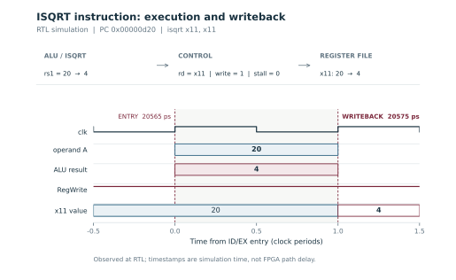

# Verification

The tests run C programs on the Verilated CVE2 core using the supplied testbench. The hardware helper emits the instruction with the assembler’s `.insn` directive. [Install the tools and run the checks](reproduce.md#run-the-simulation-checks).
{ .project-lead }

## Test sequence

| Program | Passing checks | What it verifies |
| --- | ---: | --- |
| `sw_isqrt` | 5 | Software reference cases |
| `hw_isqrt` | 2,007 | Known and randomized values, in-place execution, dependent roots |
| `isqrt_corners` | 43 | Boundary values, zero registers, illegal encodings and recovery |
| `isqrt_integration` | 200,705 | Square boundaries, full-width inputs and instruction dependencies |

### 1. Compare the software and hardware results { .project-step }

The supplied tests check known inputs with the software reference and run randomized operands through the hardware instruction. The hardware test also covers an in-place write and consecutive dependent roots.

### 2. Check boundaries and exception recovery { .project-step }

The corner tests exercise zero, the largest unsigned input, zero-register behavior, and illegal encodings. The integration test then checks the values immediately below, at and above each of the 65,535 positive square boundaries, as well as zero and `UINT32_MAX`.

### 3. Check the arithmetic and instruction dependencies { .project-step }

For another 4,096 full-width inputs, the integration test checks **root² ≤ input < (root + 1)²** with 64-bit products. The upper square can reach 2³², so it needs more than 32 bits. A dependency check runs a load into `isqrt`, stores the result, then exercises multiply, unsigned divide and compressed addition.

## Writeback in simulation

In this trace, `isqrt x11, x11` reads 20 and writes 4 to `x11` at the next simulated clock edge. The timing plot shows the RTL execution interval. The [routed timing reports](results.md#routed-timing) show the physical delay and slack for the FPGA target.

The corner and integration programs exercise selected RV32IMC instructions around the extension. See [the integration test](https://github.com/ahmedez-zouine/cve2-custom-isa-extension/blob/10f4bd0/sw/isqrt_integration.c) and the [recorded verification summary](https://github.com/ahmedez-zouine/cve2-custom-isa-extension/blob/10f4bd0/output/fpga/verified_results.md#1-instruction-and-integration-checks).
