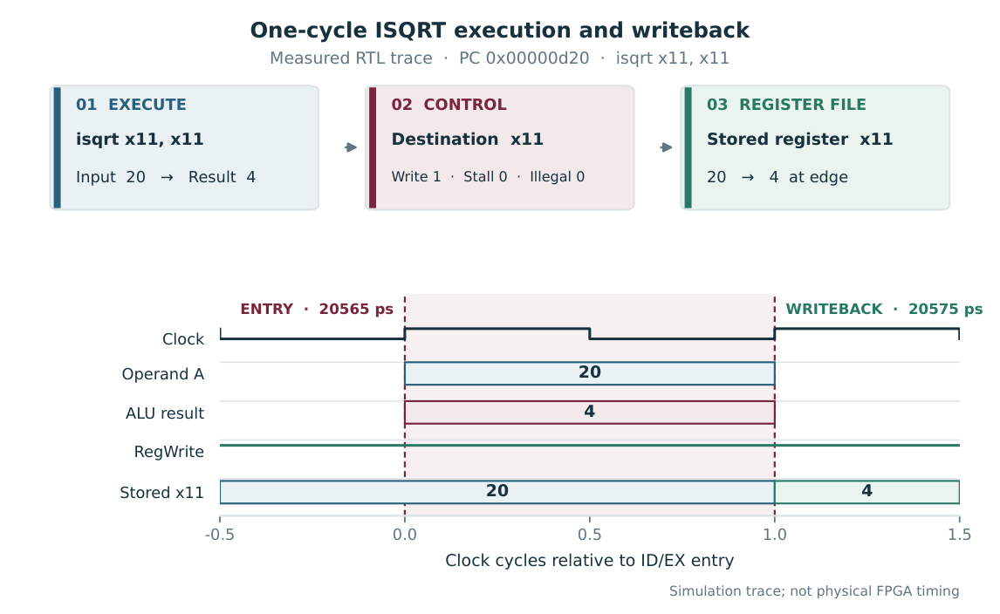

# Verification

The tests run C programs on the Verilated CVE2 core using the supplied testbench. The hardware helper emits the instruction with the assembler's `.insn` directive.

| Test | Passing checks | Coverage |
| --- | ---: | --- |
| `sw_isqrt` | 5 | Software reference cases |
| `hw_isqrt` | 2,007 | Known and randomized values, in-place execution, dependent roots |
| `isqrt_corners` | 43 | Boundary values, zero registers, illegal encodings and recovery |
| `isqrt_integration` | 200,705 | Square boundaries, full-width inputs and instruction dependencies |

The integration test covers the values immediately below, at and above each of the 65,535 positive square boundaries, as well as zero and `UINT32_MAX`. It checks another 4,096 inputs with the independent inequality `root² ≤ input < (root + 1)²` using 64-bit products. Its dependency test runs a load into `isqrt`, stores the result, then checks multiply, unsigned divide and compressed addition.

## Writeback in simulation

In this trace, `isqrt x11, x11` reads 20 and writes 4 to `x11` at the next simulated clock edge. The timing plot shows the RTL execution interval. The [routed timing reports](results.md#routed-timing) show the physical delay and slack for the FPGA target.

The corner and integration programs exercise selected RV32IMC instructions around the extension. See [the integration test](https://github.com/ahmedez-zouine/cve2-custom-isa-extension/blob/10f4bd0/sw/isqrt_integration.c) and the [recorded verification summary](https://github.com/ahmedez-zouine/cve2-custom-isa-extension/blob/10f4bd0/output/fpga/verified_results.md#1-instruction-and-integration-checks).
