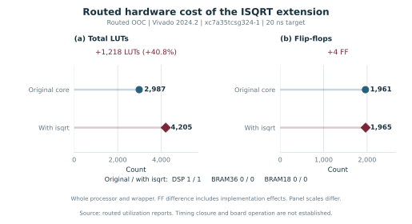
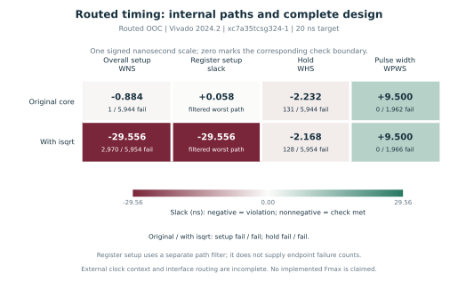
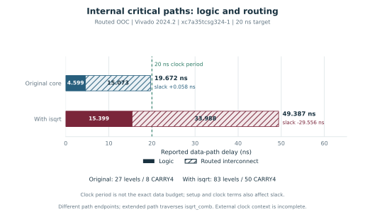
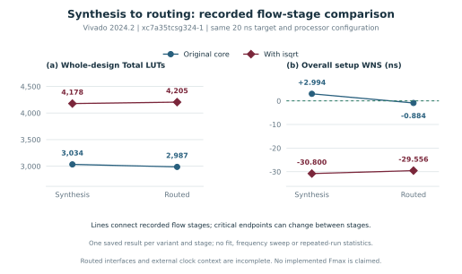

# Routed FPGA figures

These figures use the archived Vivado reports reviewed in the
[routed comparison](../fpga/implementation/comparison.md). Navy circles identify
the original core; burgundy diamonds identify the isqrt extension. Heatmap
colors encode signed slack, with zero at the center of one nanosecond scale.

## Hardware resources after routing

<p align="center">
  
</p>
<p align="center">
  <em>1,218 additional LUTs (+40.8%); no additional DSP or BRAM.</em><br>
  <a href="fig09_routed_resources.pdf">Vector PDF</a>
</p>

The counts include the core and wrapper. Physical implementation can change
the mapped FF count without adding an RTL pipeline stage. Panel scales differ.

## Overall timing and filtered register timing

<p align="center">
  
</p>
<p align="center">
  <em>The original register setup path has +0.058 ns slack; both complete designs still fail timing.</em><br>
  <a href="fig10_routed_timing.pdf">Vector PDF</a>
</p>

Only overall setup, hold and pulse-width cells have failing/total endpoint
counts. The filtered register query supplies a worst path rather than a total
failing endpoint count.

## Internal path delay contributions

<p align="center">
  
</p>
<p align="center">
  <em>The extended path traverses isqrt_comb; its wiring contributes 33.988 ns of the reported 49.387 ns path delay.</em><br>
  <a href="fig11_routed_path_delay.pdf">Vector PDF</a>
</p>

The paths have different endpoints. These are complete path delays, not an
isolated measurement of the square-root block. The 20 ns line is the clock
period; register setup and clock terms also affect the available data budget.

## Synthesis to routing

<p align="center">
  
</p>
<p align="center">
  <em>Lines connect two recorded flow stages per variant. They do not represent a frequency sweep or fitted trend.</em><br>
  <a href="fig12_fpga_stage_comparison.pdf">Vector PDF</a>
</p>

The critical endpoints can change between synthesis and routing. The two
panels use different units and axes. A positive synthesis setup estimate does
not establish routed closure.

## Evidence, limitations and reproduction

The external clock context and OOC interface routing remain incomplete. The
tile-splitting warning is unresolved, and the successful extended implementation
launch log is absent from the imported archive. The raw routed reports are
available and their limitations are retained in the comparison and manifests.
These figures do not establish implemented Fmax, power, a realized FPGA
benchmark speedup or board operation.

[Reviewed data](../fpga/implementation/implementation_results.json),
[review manifest](../fpga/implementation/review_manifest.json) and
[figure manifest](routed_figure_manifest.json) connect the plots to their inputs.
LaTeX environments are provided in [include_routed_figures.tex](include_routed_figures.tex).

From the repository root, using the figure environment:

```sh
tmp/figures_venv/bin/python -B scripts/generate_routed_figures.py --render-pdfs
```

This reads saved evidence and does not rerun Vivado or simulation. It exports
PDF, SVG and 600-dpi PNG, with a separate PNG rendered from each PDF for review.
